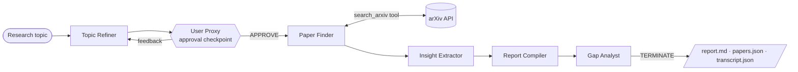

# Multi-Agent Research Automation System


A multi-agent system built with **Microsoft AutoGen** and the **OpenAI API** that automates academic
literature analysis. Give it a research interest; a team of specialised agents refines the topic,
asks you to approve the direction, searches **arXiv**, extracts insights from each paper, compiles a
structured literature review and finishes with a research-gap analysis.

```text
$ research-agents "retrieval augmented generation for medical QA"
```

## Features

- **Five specialised agents + a human** — topic refinement, paper discovery, insight extraction,
  report compilation and gap analysis, plus a `UserProxyAgent` for approval.
- **arXiv API integration** — a tool-calling agent runs multiple queries, de-duplicates results and
  stores structured paper metadata.
- **Custom selector function** — a deterministic `WorkflowRouter` replaces LLM-based speaker
  selection in `SelectorGroupChat`, routing tasks by workflow state.
- **Human-in-the-loop checkpoint** — approve, revise (with free-text feedback) or exit before any
  searching happens. Revisions loop back to the Topic Refiner, with a configurable revision budget.
- **Composable termination conditions** — `TERMINATE` from the Gap Analyst, user `exit`,
  max-message cap and wall-clock timeout, combined with `|`.
- **Saved outputs** — `report.md`, `papers.json` and the full `transcript.json` per run.
- **Offline demo mode** (`--mock`) and a test suite that runs the entire team without network or
  API keys, using AutoGen's `ReplayChatCompletionClient`.

## Architecture



| Agent | Role |
|---|---|
| `topic_refiner` | Turns a broad interest into a focused question, scope, 2–4 arXiv queries and key questions |
| `user` | `UserProxyAgent` — approves the direction, gives feedback, or exits |
| `paper_finder` | Calls the `search_arxiv` tool; its raw tool output becomes the shared paper list |
| `insight_extractor` | Problem / method / findings / limitations per paper, plus cross-paper themes |
| `report_compiler` | Thematic literature review with comparison table and references |
| `gap_analyst` | Research gaps, future directions, caveats; ends the run with `TERMINATE` |

### How routing works

`SelectorGroupChat` normally asks an LLM who speaks next. Here, `WorkflowRouter`
(`research_agents/workflow.py`) is passed as `selector_func` and derives the next speaker purely from
the message history, so execution is sequential, reproducible and cheap:

| Last speaker | Next speaker |
|---|---|
| *(task only)* | `topic_refiner` |
| `topic_refiner` | `user` |
| `user` approves (Enter, `APPROVE`, `yes`, `lgtm`…) | `paper_finder` |
| `user` gives feedback | `topic_refiner` (or `paper_finder` once the revision budget is used up) |
| `paper_finder` | `insight_extractor` (retries the finder once if it skipped the tool) |
| `insight_extractor` | `report_compiler` |
| `report_compiler` | `gap_analyst` |

Because the router is stateless (everything is computed from history), it behaves correctly if a team
is reset or resumed.

## Quick start

```bash
git clone https://github.com/<your-username>/multi-agent-research-system.git
cd multi-agent-research-system
python -m venv .venv && source .venv/bin/activate   # Windows: .venv\Scripts\activate
pip install -e ".[dev]"

cp .env.example .env          # then add your OPENAI_API_KEY
```

Try the offline demo first (no key, no network):

```bash
research-agents --mock
```

Run a real analysis:

```bash
research-agents "graph neural networks for drug discovery"
```

At the checkpoint, press **Enter** to approve, type feedback such as
`focus on molecular property prediction since 2023` to revise, or type `exit` to stop.

Outputs land in `reports/<timestamp>-<topic-slug>/`.

### CLI options

```text
research-agents [topic ...] [--model MODEL] [--max-papers N] [--per-query N]
                [--max-messages N] [--output-dir DIR] [--auto-approve] [--mock] [-v]
```

`python -m research_agents ...` works too.

### Use it from Python

```python
import asyncio
from research_agents import Settings, run_research

output, paths = asyncio.run(
    run_research("diffusion models for time series", Settings(model="gpt-4o-mini"),
                 approve_automatically=True)
)
print(output.report)
```

## Configuration

All settings can be set in `.env` (see `.env.example`) or overridden by CLI flags.

| Variable | Default | Purpose |
|---|---|---|
| `OPENAI_API_KEY` | — | Required for real runs |
| `OPENAI_MODEL` | `gpt-4o-mini` | Any OpenAI chat model with tool calling |
| `MAX_PAPERS_PER_QUERY` | `5` | Results per arXiv query |
| `MAX_TOTAL_PAPERS` | `12` | Cap on unique papers per run |
| `MAX_MESSAGES` | `40` | `MaxMessageTermination` limit |
| `RUN_TIMEOUT_SECONDS` | `900` | `TimeoutTermination` limit |
| `MAX_TOPIC_REVISIONS` | `3` | Feedback rounds before proceeding with the latest proposal |
| `REPORTS_DIR` | `reports` | Output folder |

## Project structure

```text
multi-agent-research-system/
├── research_agents/
│   ├── agents.py          # Agent factory (5 AssistantAgents + UserProxyAgent)
│   ├── workflow.py        # WorkflowRouter selector, termination conditions, team builder
│   ├── prompts.py         # System prompts per agent
│   ├── tools/arxiv_tool.py# arXiv search tool, Paper model, de-duplicating PaperStore
│   ├── runner.py          # run_research(): wires everything, streams to console
│   ├── report.py          # Builds and saves report.md / papers.json / transcript.json
│   ├── mock.py            # Scripted clients + synthetic papers for --mock and tests
│   ├── config.py          # Settings from environment
│   └── cli.py             # Command-line interface
├── tests/                 # Router, tool and full end-to-end team tests (offline)
├── docs/sample_report.md  # Example output from the offline demo
├── reports/               # Run outputs (git-ignored)
└── .github/workflows/ci.yml
```

## Testing

```bash
pytest          # 30 tests, fully offline
ruff check .
```

`tests/test_integration.py` runs the real `SelectorGroupChat` end to end with scripted model clients,
including a feedback → revision → approval loop and an early `exit` at the checkpoint.

## Limitations

- Insights are extracted from arXiv **abstracts**, not full PDFs.
- arXiv asks clients to rate-limit; the tool uses the `arxiv` library's built-in 3-second delay.
- LLM output quality depends on the chosen model; reports should be checked against the cited papers.

## Roadmap

- Full-text PDF parsing for deeper extraction
- Semantic Scholar / citation-graph discovery
- A second checkpoint to let the user prune papers before extraction
- Web UI (Streamlit) on top of `run_research`

## License

MIT — see [LICENSE](LICENSE).
